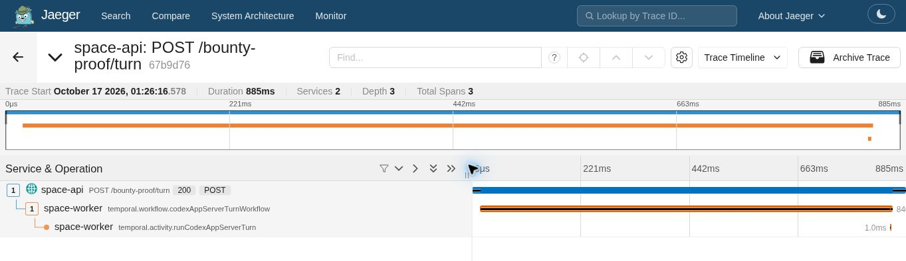

# Real Jaeger trace evidence

The recorded trace was generated by a **real loopback HTTP POST** to a small synthetic Fastify route using the shipping compiled SpaceApp API observability hooks and trace-context code. The request starts the shipping `codexAppServerTurnWorkflow` on a real Temporal test server. A stub `runCodexAppServerTurn` activity returns a completed result without calling a provider.

Both shipping exporters sent OTLP/HTTP directly to a real **Jaeger 2.22.0** collector. `jaeger-trace.json` is the **unchanged response** from the local Jaeger query service at `/api/traces/{traceId}`. It was imported through the official Jaeger demo UI's Upload control to capture the trace screenshot. It is not a trace recorded by the public demo backend.

## Observed result

- Trace ID: `67b9d7624a463a098738417c7d07b753`
- Three spans, two services, depth three, zero errors.
- API SERVER span: `892113ae56bed0a6`.
- Workflow span: `21ae7ea7fb174016`, parented to that API span.
- Activity span: `e402fa4c983ad17f`, parented to that workflow span.
- HTTP request duration: 884,524 microseconds (rounded to 885 ms by Jaeger).
- Exporters reported three exported spans, zero drops and zero failed exports.
- Synthetic prompt and provider response strings are absent from the collected trace.

`trace-verification.json` records these checked relationships. `run.json` records the generator's execution and scope. The browser displayed times in UTC+05:30; the actual run was on 2026-10-16 at 19:56 UTC.

## Reproduce

Use the supported Node 22 runtime and build the patched repository first. Start official Jaeger 2.22.0 with the supplied `jaeger.yaml` configuration; it listens only on loopback and keeps at most 100 traces in memory.

```sh
jaeger --config /absolute/path/to/jaeger.yaml
node generate-trace.cjs /absolute/path/to/spaceapp /absolute/output/dir
node export-trace.cjs /absolute/output/dir
```

Open the local Jaeger UI at `http://127.0.0.1:16686` and look up the new trace ID from `run.json`. Alternatively, use **Search → Upload** in the official demo UI at https://jaeger.demo.jaegertracing.io/ and select the generated `jaeger-trace.json` file. The public demo's trace URL alone will not reproduce imported browser-local data.

Official API documentation: https://www.jaegertracing.io/docs/2.22/architecture/apis/

`jaeger-trace-evidence.jpg` is the genuine browser screenshot attached by image link in the pull request. This folder also contains the raw data and the generator needed to reproduce the trace. This is a synthetic route with a stub provider activity, not a full application deployment or a live provider run.


